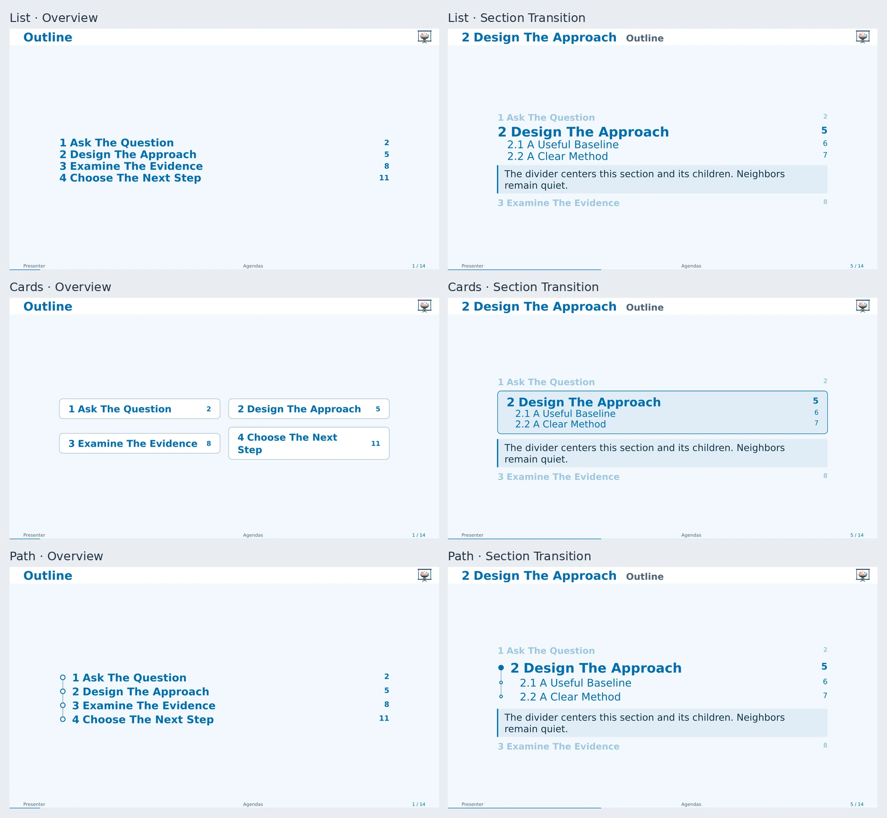

# Agendas

`outline-slide` and automatic `new-section-slide` share `"list"`, `"cards"`, and
`"path"` renderers. Set `agenda-style` on the theme, or `style` on one helper.



| Style | Use |
| --- | --- |
| `"list"` | Compact hierarchy; default and best for long agendas. |
| `"cards"` | Section cards in up to two overview columns. |
| `"path"` | Connected hierarchy with a highlighted current node. |

```typst
#show: ambrosia-theme.with(
  agenda-style: "cards",
  config-common(new-section-slide-fn: new-section-slide.with(neighbors: 1)),
)
#outline-slide(depth: 1)
#outline-slide(style: "path", title: [Where We Are])
```

## Text Size And Chapter Summaries

Agenda text defaults to `1.15em`, relative to the presentation's body size.
Change `agenda-text-size` on the theme, or `text-size` on one agenda helper:

```typst
#show: ambrosia-theme.with(agenda-text-size: 1.2em)
#outline-slide(text-size: 20pt)
```

A chapter summary is the content between its section heading and first slide:

```typst
= Design The Approach
Explain the aim of this chapter in one or two sentences.
== A Useful Baseline
The first content slide.
```

The automatic divider shows that summary in a quiet, left-aligned accent panel
below the section's headings. Summaries are fitted with the agenda and can
contain reveals. A section without a summary gets no panel and no extra space;
speaker notes alone do not count as a summary. Each summary belongs to its own
section and never carries over to the next section or the appendix.

## Select And Fit

`depth`, `level`, and `numbered` select headings and their prefixes. Trailing
numbers refer to logical slides; animation frames share an entry. Main and
appendix outlines remain separate, and appendix entries use the theme's
[appendix numbering](people.md#appendix-numbers).

Dividers focus on the current section and its children. `neighbors: 0`, `1`, or
`2` adds quiet surrounding sections. Fitting first drops neighbors, then excess
depth, then uses a linked omission window. No style spills onto another page.

`outline-min-scale` defaults to `80%`; `min-scale` overrides it locally.
`start: 15` opens a forward window at entry 15; `overflow: "error"` requests a
diagnostic instead. Cards fall back to a list beyond six root sections or
eighteen eligible headings.

## Leaders

```typst
#show: ambrosia-theme.with(outline-fill: repeat[.])
#outline-slide(fill: none) // local override
```

The default is `none`; `fill: auto` inherits the theme. These custom agenda rows
are separate from native `outline.entry` styling.

[Editable agendas](../examples/agendas.typ)
