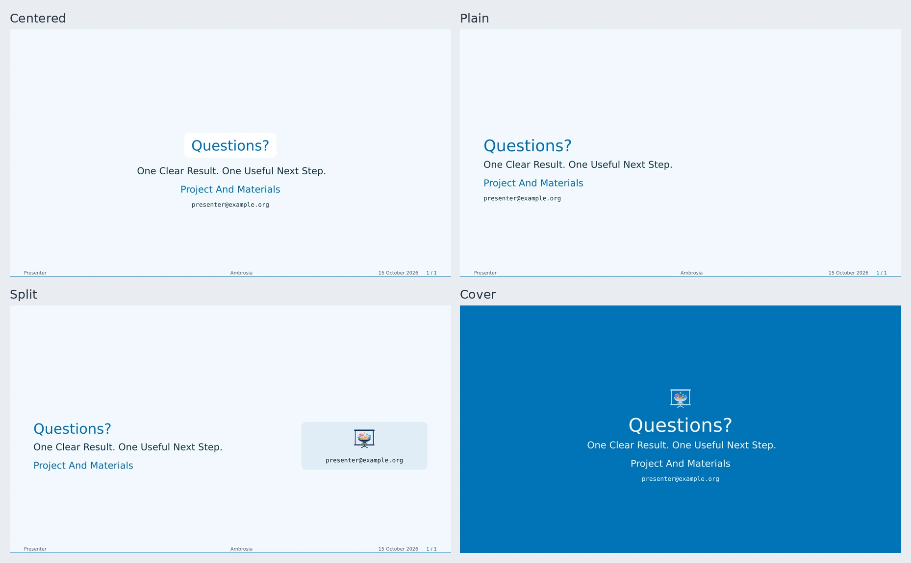

# Ending Layouts

Choose `ending-layout` on the theme or `ending-slide(layout: ...)` locally.
`auto` follows the flavor; a local layout takes precedence.



| Layout | Composition |
| --- | --- |
| `"centered"` | Questions/thanks panel, body, and contacts. |
| `"plain"` | Left-aligned text and contacts. |
| `"split"` | Takeaways beside a logo/contact card. |
| `"cover"` | Full-page color or optional photograph. |

```typst
#show: ambrosia-theme.with(
  ending-layout: "split",
  config-info(email: "person@example.org"),
)
#ending-slide(title: [Questions?])[
  - One result to remember.
  - One useful next step.
]
```

## Contacts And Logos

Contacts use shared `emails` / `email`, otherwise the authors' personal
addresses. Local `contacts: (...)` replaces the list; `none` hides it.
Use native links in the body for websites or materials.

`ending-logos: auto` collects the primary marks. Split displays them in its card,
cover above the title; centered/plain hide them. Set `ending-logos` or local
`logos` for a replacement collection. An empty split card releases its column.

Endings count as logical slides. Their bodies retain native flow, footnotes,
citations, and reveals; dense body content is not automatically scaled.

## Adjust A Preset

```typst
#let closing = ambrosia-ending-layout(base: "split",
  side-width: 38%, logo-height: 2em, title-size: 1.7em)
#ending-slide(layout: closing, title: [Keep In Touch])[
  #link("https://example.org/project")[Project And Materials]
]
```

Descriptors share the [title-layout options](title-layouts.md#adjust-a-preset):
alignment, logo sizing/placement, title treatment, spacing, side panel, page
colors, and background image/overlay. Fill/ink values may be callbacks.
Use `ending-renderer` only for a [fully custom composition](extensions.md).

[Editable ending comparison](../examples/ending-layouts.typ)
