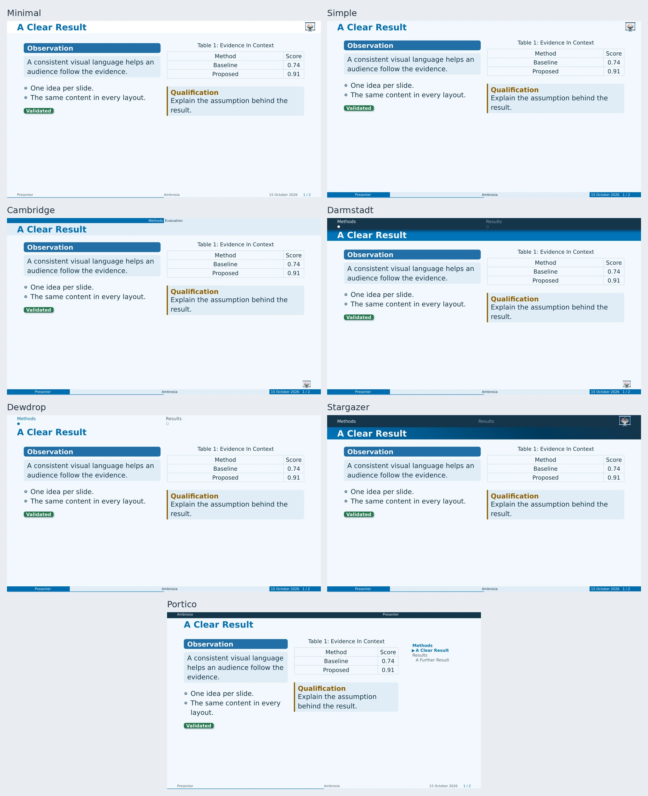

# Flavors

A flavor sets header/footer geometry, logo placement, spacing, and component
presets. `palette` supplies colors; `navigation` can replace the suggested
navigator independently.



| Flavor | Character | Default Navigation |
| --- | --- | --- |
| `"minimal"` | Quiet heading and compact footer. Default flavor. | None |
| `"simple"` | Spacious classic composition. | None |
| `"cambridge"` | Structured section/subsection bands. | Context |
| `"darmstadt"` | Structured bands and a footer logo. | Dots |
| `"dewdrop"` | Lightweight heading and slide dots. | Dots |
| `"stargazer"` | Accent heading and linked section tabs. | Tabs |
| `"portico"` | Metadata band, flat panels, and a side outline. | Sidebar |

```typst
#show: ambrosia-theme.with(
  flavor: "stargazer", palette: "midnight", navigation: "tree",
)
```

Most flavors use `==` slide headings; Cambridge uses `===`.
Explicit `slide(...)` works in every flavor.

## Portico's Side Panel

`sidebar-background: none` keeps the column transparent. `auto` enables the
flavor's contrasting paint; a solid color sets your own. Move it with
`navigation-side: "left"` or change the width with `navigation-width`.

Choosing another navigator releases the side column while retaining Portico's
metadata band, spacing, and flat surfaces.

Use `title-layout` and `ending-layout` for separate opening/closing compositions.
For a reusable custom preset, see [flavor descriptors](extensions.md).
