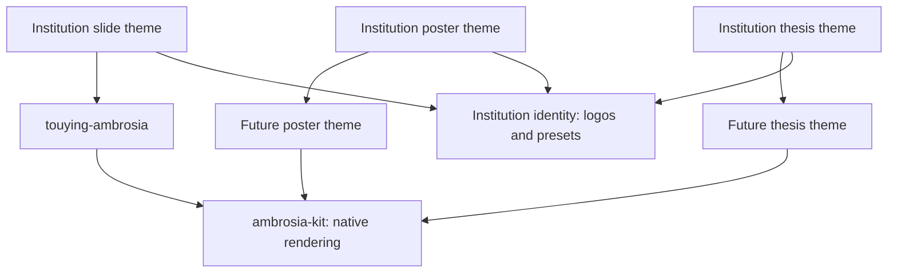

# Components Across Presentations, Posters, And Theses

Ambrosia's visual vocabulary can serve more than slides. Share the native
rendering code once a second document family needs it; keep the adapters
specific to their document model. A poster or thesis should not import Touying
just to draw a block.

## A Practical Package Boundary

A future neutral package, provisionally **`ambrosia-kit`**, could own:

- Semantic palette records, contrast helpers, and SVG color transformations.
- Native block styles, badges, shadows, and text-emphasis treatments.
- Native roadmap rendering and explicit project-credit cards.
- Small layout/measurement helpers that operate on a containing region.

The public renderers should accept explicit tokens and content, with usable
neutral defaults. A token record can supply primary/semantic colors, foreground,
surfaces, borders, and typography. It must not require a Touying `self`, slide
counter, navigation store, or presentation show rule.

The names for future packages are suggestions, not published dependencies.
Institution identity should be a separate, small asset/preset layer when several
institution wrappers need it. Full and compact logos, traits, team identifiers,
source colors, and institution marks belong there. Each package should resolve
its own asset paths to content/bytes before passing them to another package.

## Keep The Touying Adapter Thin

Today, `component-wrapper` records a Touying raw-function wrapper. Touying uses
that protocol to inspect nested content and resolve pauses before rendering.
`render-ambrosia-block` then reads palette/default values from `self`.

At extraction time, split these responsibilities:

1. A native renderer receives resolved tokens, options, and normal Typst content.
2. The presentation wrapper retains the raw-function protocol, obtains tokens
   and flavor defaults from `self`, then calls that renderer.
3. Poster/thesis adapters supply their own defaults and document policy.

The existing presentation names, such as `ambrosia-block` and `ambrosia-badge`,
can stay unchanged. Consumers of the kit can use scoped names such as `kit.block`.
Blocks should preserve semantic kinds and style descriptors across document
families without imposing slide-sized typography.

Page-breaking policy belongs to the adapter. Slide panels are normally
unbreakable; thesis panels may need a breakable variant, continuation headings,
and borders across pages. Poster columns need stable alignment and explicit
height budgets. Those are behavioral differences, not just different colors.

## What Stays Presentation-Specific

Keep slide/navigation queries, animation handling, appendix counts, title/ending
composition, slide thumbnails, and slide fitting in `touying-ambrosia`. Footnote
citation deduplication and pagination also need document-specific policies;
a thesis should not inherit slide-local resets. Shared CSL/data helpers can be
extracted separately only if the second consumer proves their semantics match.

Do not move every helper into a general package simply because it draws content.
Author metadata and affiliation links may later be reusable, but thesis front
matter has different numbering, legal text, and ordering constraints.

## When To Extract

Start the poster prototype with Typst's native page, grid, block, text, and figure
primitives. A thesis can likewise build on native headings, counters, page styles,
and bibliographies; neither needs a framework matching Touying's animation and
slide engine. Use focused libraries where they solve a concrete need.

When the poster actually needs the same blocks and badges, first separate their
renderers internally and prove them in both consumers. Then publish a small kit
and make the presentation package depend on it. Keep a temporary prototype copy
only during that experiment; avoid maintaining duplicate released implementations.
A poster prototype provides better evidence for the boundary than a speculative
three-package refactor now.

Validation should cover standalone native use, Touying nested reveals, readable
light/dark surfaces, inherited text size, and copied-package consumers outside
all checkouts. Add multipage tests only when a thesis adapter introduces
breakable components. Pin released dependency versions and update adapters
explicitly when the kit changes.

## Component And Slide-Type Design Notes

## Utility Design

Block treatments belong in one `style:` API because they share the same content model, nesting, animation handling, and options. `ambrosia-block.with(...)` provides named local presets without duplicating implementations. Separate packages/modules are more appropriate for independent systems with different semantics, such as theorem numbering and proof references.

`ambrosia-badge` and `ambrosia-source-note` fill small annotation gaps. [`ambrosia-roadmap`](../roadmap.md) handles a more distinct data/layout problem: aligned time spans, concurrent work, queued detail rows, and fitting. Existing `alert`, block, outline, and citation helpers cover most other research talk needs.

## Alternative Slide Layouts

Title and ending slides carry enough structured metadata to justify named
layout presets. Other slide types benefit from fewer, narrower choices:

| Slide family | Existing coverage | A useful next extension, if needed |
| --- | --- | --- |
| `focus-slide` | Arbitrary content, alignment, fill, and text color. | A simple layout override only if repeated presentations establish another composition. Image-backed quotes can already use page configuration. |
| `image-slide` | Full-page imagery, contain/cover fitting, native caption placement, panel width/margins, and credit. | Use a band or corner card; a figure with adjacent explanation belongs in a native grid. See [image captions](../image-slides.md). |
| `section-slide` | Centered title, optional subtitle, logo, and content. | A restrained alternative such as a section number beside the title, if widely reused. |
| `outline-slide` and automatic dividers | Fitted list, short-deck cards, or a connected path; current branch centered on automatic dividers. | Select `agenda-style` globally or `style` per helper. See [agendas](../agendas.md). |

Agenda styles share the same scoped, deduplicated heading selection, logical
slide links, fitting, omission accounting, and appendix scope. Cards fall back
to the compact list for long decks. See [the style and fitting guide](../agendas.md).

A poster, metric card, comparison, or process diagram still does not need a new
slide helper merely to arrange a grid. Preserve ordinary Typst composition until
a repeated content model or automatic behavior earns its own component.

## Future Navigation Variants

A local slide-step strip is a possible future dot variant. A thumbnail overview
belongs to slide composition and the preview export workflow rather than
persistent page navigation.

