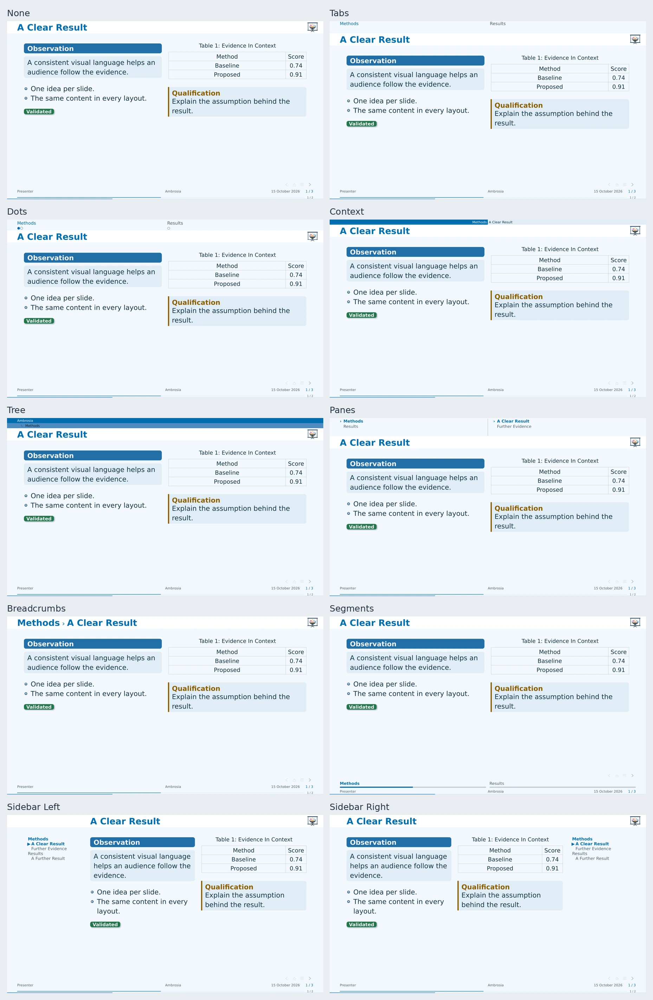

# Navigation

Choose `navigation` independently of flavor. `auto` keeps the flavor's preset;
`none` removes structural navigation and releases its space.

<!-- ambrosia-example: navigation -->
[Editable source](site/examples/navigation.typ).
<!-- /ambrosia-example -->

## Choose A Navigator

| Value | Arrangement |
| --- | --- |
| `"tabs"` | Linked level-one section labels in the header. |
| `"dots"` | Logical-slide dots grouped by section. |
| `"context"` | Current section and subsection in a compact band. |
| `"tree"` | Talk title and current ancestors in thin, indented strips. |
| `"panes"` | Sections beside the current section's children. |
| `"breadcrumbs"` | Linked ancestor path in the slide-title slot. |
| `"sidebar"` | A bounded outline in a reserved side column. |
| `"segments"` | Section labels with local progress in a footer rail. |



Header bands, sidebars, and footer rails reserve their own space. Crowded views
window around the current position with linked omission markers. Animation
frames share one logical position; main talk and appendix have separate scopes.

```typst
#show: ambrosia-theme.with(navigation: "sidebar")
#slide(config: config-store(navigation: none))[A wider figure.]
```

## Sidebar

| Option | Default / Effect |
| --- | --- |
| `navigation-side` | `"right"`; also accepts `"left"`. |
| `navigation-width` | `9em`, plus a `0.8em` gap. |
| `navigation-depth` | `2`; maximum outline depth. |
| `sidebar-background` | `none`; `auto` uses the flavor's paint, or supply a solid color. |

Current entries and ancestors remain prominent. Long outlines collapse inactive
children, then window around the active entry. Special title, focus, image,
section, and ending slides hide the sidebar; a local
`config-store(navigation: "sidebar")` opts one back in. Agenda transitions keep it.

## Trees, Panes, And Breadcrumbs

Tree strips show only the current path; panes also show neighboring choices.
A tree uses `0.75em` per row by default. `navigation-depth` limits its ancestor
rows; a descriptor's `height` can set an explicit budget. The talk row uses
`short-title`, falling back to the full title.

Panes reserve `2.7em`, with independently windowed section/child lists.
Breadcrumbs reuse the ordinary title slot and retain explicit slide titles.
Long paths collapse intermediate ancestors and truncate long labels.

## Section Rails And Progress

`"tabs"` and `"segments"` both show level-one sections. Segments add progress
within each section and use a `1.35em` footer row. Move the same rail into the
header through a descriptor:

```typst
#let rail = ambrosia-navigation(base: "segments", placement: "header")
#show: ambrosia-theme.with(navigation: rail)
```

`section-progress: true` independently adds a small footer progress indicator.
`progress-bar` controls the global bar. The footer order is logo/buttons, then
segments, then metadata and progress.

## Transparent Buttons

```typst
#show: ambrosia-theme.with(
  navigation-buttons: true,
  navigation-buttons-opacity: 35%,
  navigation-buttons-actions: ("previous", "section", "outline", "next"),
)
```

Actions are `"first"`, `"previous"`, `"section"`, `"outline"`, `"next"`, and
`"last"`. Unavailable targets are dimmed. Buttons share the compact footer logo
row; a custom footer uses the overlay fallback.

For manual placement, call `ambrosia-navigation-buttons(actions: ..., opacity:
60%, fill: ...)`. It reserves no page margin. Handout, notes-only, and article
output suppress automatic navigation; second-screen notes keep it on the slide
half. Native PDF links require a viewer that supports following them.

## Custom Descriptors

```typst
#let wide = ambrosia-navigation(base: "sidebar", name: "wide",
  side: "left", width: 10em, gap: 1em, depth: 3)
#show: ambrosia-theme.with(navigation: wide)
```

Descriptor keys include `name`, `kind`, `placement`, `height`, `width`, `gap`,
`side`, `depth`, and `renderer`. A custom `renderer: self => content` must fit
its declared region. Custom page headers/footers own their spacing; the
`navigation-header-managed` and `navigation-footer-managed` store flags opt
into automatic reservations.

[Editable navigator comparison](../examples/navigation.typ) · [Linked slide previews](slide-previews.md)
