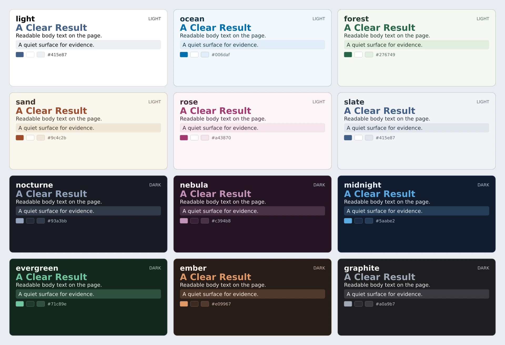

# Palettes

Every flavor accepts every palette. Start from one of twelve presets:
`light`, `ocean`, `forest`, `sand`, `rose`, `slate`, `nocturne`, `nebula`,
`midnight`, `evergreen`, `ember`, or `graphite`.



## Make Your Own

<!-- ambrosia-example: palette -->
[Editable source](site/examples/palette.typ).
<!-- /ambrosia-example -->

`ambrosia-palette` accepts a preset name or descriptor as `base`. `primary` sets
an accent seed; `light` also derives an alternate surface from it. Other bases
retain their curated surfaces.

```typst
#let violet = ambrosia-palette(base: "ocean", rotate: 65deg)
#let paper = ambrosia-palette(base: "light", primary: rgb("2b6b51"),
  background: rgb("faf7f0"), surface: rgb("fffdf7"))
```

`rotate` shifts hues in OKLCH before explicit overrides. Semantic
info/success/warning/danger colors stay unchanged unless overridden. Start from
a dark preset for a dark theme; changing `dark` alone is insufficient.

| Roles | Purpose |
| --- | --- |
| `background`, `foreground` | Page and body ink. |
| `surface`, `surface-alt`, `muted`, `border` | Panels and secondary detail. |
| `chrome`, `on-chrome`, `chrome-muted` | Navigation surfaces and ink. |
| `info`, `success`, `warning`, `danger` | Semantic accents. |
| `cover`, `on-cover`, `on-accent`, `accent-strong`, `on-accent-strong` | Advanced surface/ink pairs. |

Accent, semantic, and muted text are adjusted for contrast. Explicit ink
choices remain your responsibility.

## Showcase The Active Colors

`ambrosia-palette-showcase()` reads the current palette, including local slide
overrides. Options include `roles: ("primary", "surface", "foreground")`,
`columns: 3`, `title: none`, and `codes: false`. It also works inside a block.

[Editable palettes](../examples/palettes.typ)
