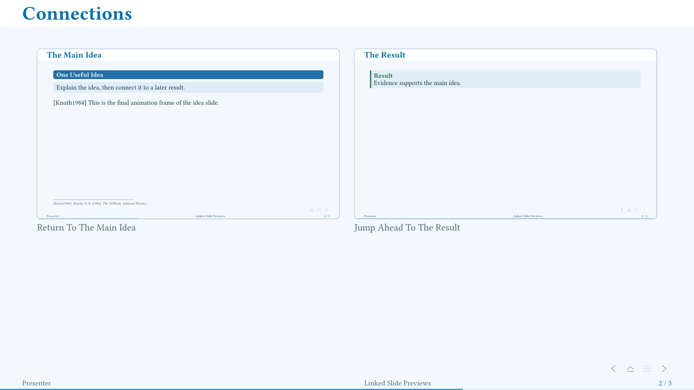

# Linked Slide Previews

`ambrosia-slide-preview` places a clickable thumbnail of another slide. It
supports forward/backward links and a selected animation frame.



The [complete example](../examples/slide-previews.typ) links to an earlier
slide's final frame and a later result. The screenshot shows the arrangement;
the links are interactive in the [compiled PDF](../examples/slide-previews.pdf).

```typst
== The Result <result>
The evidence.

== Discussion
#ambrosia-slide-preview(<result>,
  thumbnail: image("previews/result.svg"),
  width: 35%, caption: [Return To The Result], frame: "first")
```

For an explicit `slide`, put the anchor **inside** its body:
`#metadata(none)<result>`. An outer `#slide[...]<result>` label is reserved by
Touying for recall and is not a queryable page anchor.

| Option | Default / Meaning |
| --- | --- |
| `thumbnail` | Image content; omitted gives a clickable placeholder. |
| `frame` | `"first"`, `"last"`, or a positive frame number. |
| `width` | `35%`; use `100%` in a grid cell. |
| `aspect-ratio` | Host theme's ratio; override for a differently shaped target. |
| `radius`, `stroke`, `caption` | Frame and linked label styling. |

## Supply An Image Or Export Exact Snapshots

An uploaded slide image works directly in the web editor. Exact snapshots need
a separate local export: Typst cannot reuse a completed page as an image during
the same compilation.

The optional [Python helper](https://github.com/inspiros/touying-ambrosia/raw/refs/tags/v0.1.0/scripts/render-slide-previews.py)
needs only Python 3.9+ and the Typst CLI. No repository clone is required.
It exports requested pages to SVG and writes a manifest; normal compilation
then loads those images without replaying live counters or citations.

Use the [complete example](../examples/slide-previews.typ) for its small
manifest-loading helpers. For your own deck, start with its previews disabled,
then run:

```sh
python3 render-slide-previews.py talk.typ --root .
```

The default output is `target/slide-previews/manifest.json` plus SVGs.
Set the source's preview directory to that folder, enable previews, and compile
normally. Paths remain relative to the source. `--output-dir` changes the
folder; `--package-path` and `--input key=value` forward build settings.

Regenerate after changing target content, frames, layout, palette, or output
mode. Browser-only projects can upload the generated SVGs and manifest.
The shipped example already includes snapshots, so it opens without this step.
