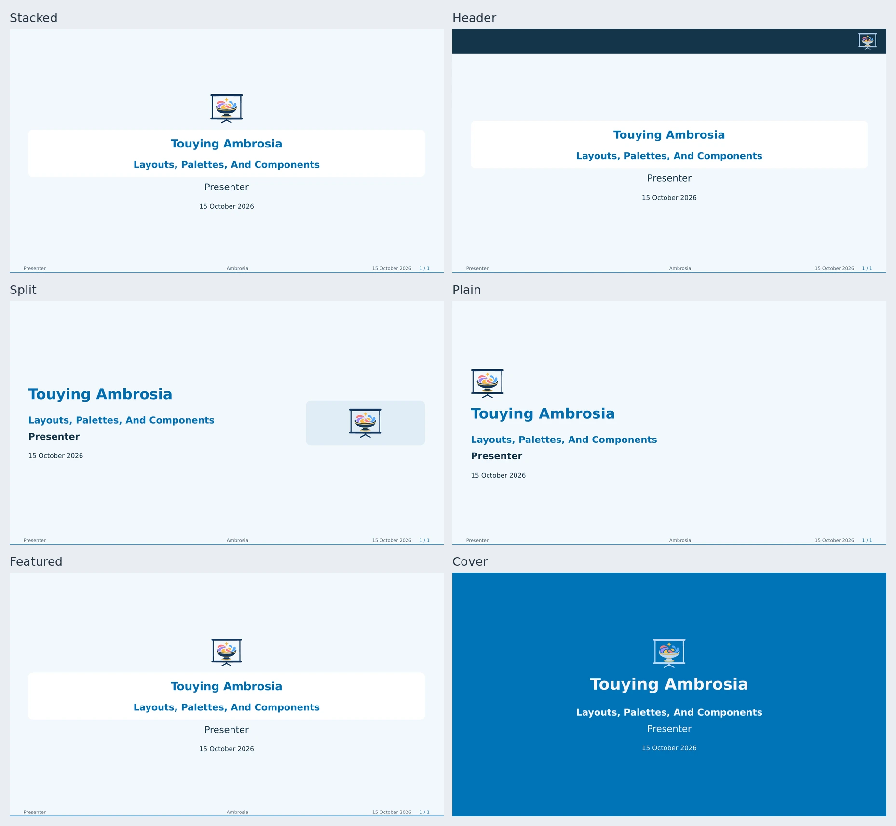

# Title Layouts

Set `title-layout` on the theme, or `layout` on one `title-slide`. Local choices
win over theme settings, then flavor defaults. `auto` follows the flavor.



| Layout | Composition |
| --- | --- |
| `"stacked"` | Centered logo row, title panel, and metadata. |
| `"header"` | Logos in a reserved top band. |
| `"split"` | Left-aligned text beside a logo panel. |
| `"plain"` | Left-aligned logos and text, without a panel. |
| `"featured"` | Prominent primary marks; smaller partners below. |
| `"cover"` | Full-page color or photograph, without ordinary chrome. |

```typst
#show: ambrosia-theme.with(title-layout: "header")
#title-slide()
#title-slide(layout: "split", subtitle: [Another Opening])
```

## Logos

`title-logos: auto` collects `primary-logos`, then `logos`.
`title-logos: (...)` or local `title-slide(logos: (...))` replaces the complete
collection; `none` hides it. Images retain their proportions and wrap into rows.
`logo-columns: auto` uses up to six columns, or one in a split panel.

The header band reserves its own space and disappears when no logos are present.
Featured layouts give primary marks a separate region and center the partners.
For equal or left/right grouping, see [branding](branding.md).

## Adjust A Preset

```typst
#let opening = ambrosia-title-layout(base: "header",
  logo-height: 2em, logos-align: right,
  title-radius: 0em, title-shadow: false)
#title-slide(layout: opening)
```

| Options | Control |
| --- | --- |
| `alignment`, `composition` | Text alignment; centered or split geometry. |
| `logos-placement`, `logos-align`, `logos-distribution` | Position and equal/grouped distribution. |
| `logo-height`, `logo-columns`, `logo-gap` | Bounded logo cells. `auto` height follows `title-logo-height`. |
| `featured-logo`, `featured-logo-height` | A larger primary region. |
| `header-background`, `header-inset` | Top band's fill and padding. |
| `title-background`, `title-text`, `title-shadow`, `title-width` | Title treatment; `auto` follows the flavor. |
| `title-size`, `subtitle-size`, `title-inset`, `title-radius`, `gap` | Typography and spacing. |
| `side-width`, `side-background` | Split panel. |
| `immersive`, `page-background`, `foreground` | Page chrome and colors. |
| `background-image`, `background-overlay` | Optional photograph and contrast overlay. |

Fill/ink options accept values or `self => value` callbacks. Logo callbacks
receive their actual surface in `self.store.logo-background`.

```typst
#title-slide(layout: ambrosia-title-layout(base: "cover",
  background-image: image("photograph.webp", width: 100%, height: 100%, fit: "cover"),
  background-overlay: self => self.colors.cover.transparentize(35%),
))
```

## Fit And Overrides

Title metadata scales together down to `title-min-scale: 65%` by default.
`title-fit`, or local `fit` / `min-scale`, controls fitting. The header logo band
keeps its size; metadata fits the remaining region. Content that still cannot
fit produces a diagnostic rather than another page.

A native layout choice overrides a flavor's custom title renderer. For a fully
custom cover, use the [extension hooks](extensions.md).

[Editable title comparison](../examples/title-layouts.typ) · [Ending layouts](ending-layouts.md)
